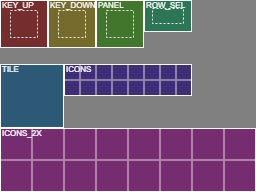

# GTi skins

A skin is your own look for the GTi screen, in one file. You draw it as an ordinary picture in any paint program, import it in the web page, and the screen shows it live. Colours, key shapes, the panel behind the cover and the selected row in a list can all change. A skin is shared as a single `.gts` file: post it in Discord, mail it, or drop it on the SD card.

Skins work on the JC3248 screen only for now (the 3.5 inch GTi). The format is the same for every screen, so the other screens can follow without changing your skins.

Firmware: `A600-skin1-JC3248` or later.

## The four steps

1. **Download the starter.** Open the GTi's web page, go to the **Themes** tab, open the Theme Editor and press **Download starter skin**. You get `GTI_STARTER.png`: NEO, the default look, laid out in the slots below. The page draws it itself, so this works on a phone that is only connected to the GTi's own Wi-Fi and has no internet.
2. **Edit the PNG.** Paint over it in any program that keeps transparency. Keep the size (256 x 192 pixels) and keep the slots where they are. Press **Download slot map** to get `GTI_SLOT_MAP.png`: the same picture with every slot labelled, so you can see what goes where (a copy is in this folder as `slot-map.png`). Set the colours in the editor (the same colour fields as a colour theme). They colour everything the skin leaves alone, and the key text uses the `text` colour, so if you draw light keys, pick a dark text colour.
3. **Import it.** Type a name (A-Z, 0-9 and `_`, at most 16, not starting with a digit), press **Import skin (PNG or .gts)** and pick your file. A `.gts` that someone else made works the same way. The page checks the file first and tells you in plain words what is wrong, for example "atlas is 300 px wide, expected 256", before anything is sent to the screen.
4. **It shows up live.** Activate it (Save & activate) or pick it on the screen: Settings, THEME. Your skin sits in the list next to the colour themes. Choosing a skin switches NEO off, because the skin replaces the NEO look. To go back, pick NEO or any colour theme.

To change a skin you already have, enter its name and press **Export skin**: the page gives you the `.gts`, the atlas PNG and each background picture, and loads the colours into the editor.

To remove a skin, pick it under **Start from** and press **Delete skin** (the button shows only for a skin). If it was the active look, the screen goes to NAVY.

Old `CONFIG.TXT` files keep working. `THEME=<NAME>` selects a skin exactly like it selects a colour theme.

## The slots

The picture (the atlas) is always 256 x 192 pixels, RGBA, with real transparency. Each slot is a fixed rectangle in it. The screen cuts the rectangle out and draws it. The keys, the panel and the selected row are 9-slice: the corners stay as they are and the edges and the middle stretch, so one key picture serves every key size. Keep the corner art inside the border width given below.

This table is generated from `firmware/shared/skin_draw.h` by `tools/render_skin_slots.py`, so it cannot drift from the firmware.

Slot list version 1, atlas 256 x 192 pixels.

| Slot | x | y | width | height | 9-slice border | What it is |
|---|---|---|---|---|---|---|
| `KEY_UP` | 0 | 0 | 48 | 48 | 10 | Key face, normal. Every button, stretched to its size (9-slice). |
| `KEY_DOWN` | 48 | 0 | 48 | 48 | 10 | Key face, pressed. Same size and border as KEY_UP. |
| `PANEL` | 96 | 0 | 48 | 48 | 10 | Cover and info panel background (9-slice). |
| `ROW_SEL` | 144 | 0 | 48 | 32 | 8 | The selected row in a list (9-slice). |
| `TILE` | 0 | 64 | 64 | 64 | - | Tiny repeating background, used when the skin has no background picture for the screen's size and orientation. |
| `ICONS` | 64 | 64 | 128 | 32 | - | Icon grid, 8 x 2 cells of 16 x 16. Reserved for a later version: the screen does not draw it yet. |
| `ICONS_2X` | 0 | 128 | 256 | 64 | - | Icon grid for large screens, 8 x 2 cells of 32 x 32. Reserved for a later version: the screen does not draw it yet. |

`neo-starter.png` in this folder is the starter as the page draws it, for anyone who wants it without opening the web page.

Icons: the icon area exists in the starter and in the slot list, but the screen does not draw icons from a skin yet. Anything you paint there is ignored for now. The cells are reserved for a later version, so a skin made today will keep working then. Do not rely on icons.

## Backgrounds

A skin may carry a full-screen background picture. It must be a **baseline JPEG** (not progressive) of exactly one of these sizes: 480 x 320, 320 x 480, 480 x 272 or 272 x 480. A skin may carry up to four, one per size.

The screen uses the picture that matches its size and the way it is held when the skin is loaded, and loads the right one again when you rotate the screen. If the skin has no picture for the current size and orientation, the screen repeats the `TILE` slot (64 x 64) over the whole background instead. If the TILE slot is empty too, it uses the colour theme's background. In the editor you can pick a photo and a size: the page crops it to fill that size and saves it as a baseline JPEG for you. A progressive JPEG inside a `.gts` you import is converted by the page.

## Limits

- The whole `.gts` file is at most 256 KB (262144 bytes).
- The atlas is exactly 256 x 192 pixels, as an 8-bit RGBA PNG. The page converts other PNG types for you, but not other sizes.
- The manifest (the colours, the name and the author) is at most 1024 bytes.
- Colour themes and skins share one list of 8 custom entries, the same cap as before skins.
- Slot list version 1. A file for a slot list this firmware does not know is refused.

## Fallbacks: a skin cannot hurt

- A missing or empty slot is drawn the classic way (the colour theme and the `BTNSTYLE=` setting), piece by piece.
- A file that is damaged or does not fit is refused with a plain message in the web page, and refused again by the screen if it ever got that far. The look stays as it was. At boot a `.gts` that cannot be read falls back to NAVY, with one line in the log.
- If the screen is short of memory, the skin is refused with "not enough memory". What you then see depends on when it happens:
  - picking the skin (web page or THEME page): the look stays as it was, and the web page shows the reason;
  - at boot, after a RESCAN, or when the skin on screen is replaced by an upload: NAVY, with one log line ending `- NAVY instead`.
  A background that does not fit is dropped alone: the skin still loads, with the tile.
- The state markers the screen draws itself (the green edge for on, the `> <` marks, the INSERT and EJECT colours) are drawn over the skin art, so a skin cannot hide them.
- A background for the wrong size is skipped, never shown stretched.

## Numbers

Flash, the JC3248 sketch, from the build reports (`huge_app` partition, 3145728 bytes available):

| Step | Sketch size | Change |
|---|---|---|
| Before skins | 1960658 bytes | - |
| Loader and container, no caller yet | 1960694 bytes | +36 (the linker drops code nothing calls; the real cost was about 1 KB) |
| States and NEO-off work | 1960282 bytes | -412 (still dead-stripped) |
| Lists, config and reload on rotation | 1977314 bytes | +17032 (the first build with the skin code really linked in) |
| Upload, download and delete in the panel | 1982834 bytes | +5520 |
| Skin card in the web page | 1987970 bytes | +5136 |
| Import checks and editor fixes (final) | 1989106 bytes | +1136 |
| With the `A600-skin1-JC3248` version text | 1989090 bytes | -16 (the shorter version string) |

In total skins cost 28448 bytes (1989106 against 1960658) of flash (about 1.5 percent; the sketch is 63 percent of the partition). About 6 KB of that is the web page: it is stored gzipped, and its source grew by about 16 KB. The JC4827 and P4 sketches share that web page and pick up about the same growth when they are rebuilt; they were not built for skins.

PSRAM: **to be measured on the device.** The device was not available when this was written, so there are no PSRAM numbers here and none were guessed. The firmware logs what is needed. Look for these lines in the log:

- `[skin] NAME loaded: atlas 256x192, background tile 0x0, NEO on` (or `background picture 480x320`, or `background colours 0x0`), followed by `[skin] psram X -> Y`: free PSRAM before and after loading. Expect the atlas to cost about 147 KB (256 x 192 x 2 bytes of colour + 256 x 192 bytes of alpha = 147,456 bytes) and a 480 x 320 background about 300 KB more.
- The same with NEO off, and with no skin active, to compare the three cases.
- `[skin] NAME: not enough memory - look unchanged` (when picked) or `... - NAVY instead` (at boot, RESCAN or a replace) means the memory floor was hit (1088 KB has to stay free for the library, plus the skin).

Fill in the measured values here after the first run on the device.
