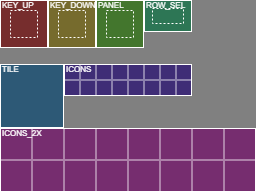

# GTi skins

A skin is your own look for the GTi screen, in one file. You draw it as an ordinary picture in any paint program, import it in the web page, and the screen shows it live. Colours, key shapes, the cards, the rows and the selected row in a list can all change. A skin is shared as a single `.gts` file: post it in Discord, mail it, or drop it on the SD card.

Skins work on the JC3248 screen only for now (the 3.5 inch GTi). The format is the same for every screen, so the other screens can follow without changing your skins.

Firmware: `A600-skin1-JC3248` or later. The calm screens (A600-calm1 and later) draw from the same slots; the section "What the calm screens draw from a skin" below says which part uses which slot. A `.gts` made for `A600-skin1` still loads and looks right: no slot was added, moved or dropped.

**No paint program handy, or want to see it first?** The [skin editor](../skin-editor.html) (on the GitHub Pages site) draws the real calm screens with your skin as you work, and exports the `.gts`. It runs in your browser and cannot send the file to the GTi itself: import it through the GTi's own page, or copy it to the SD card.

## The four steps

1. **Download the starter.** Open the GTi's web page, go to the **Themes** tab, open the Theme Editor and press **Download starter skin**. You get `GTI_STARTER.png`: NEO, the default look, laid out in the slots below. The page draws it itself, so this works on a phone that is only connected to the GTi's own Wi-Fi and has no internet.
2. **Edit the PNG.** Paint over it in any program that keeps transparency. Keep the size (256 x 192 pixels) and keep the slots where they are. Press **Download slot map** to get `GTI_SLOT_MAP.png`: the same picture with every slot labelled, so you can see what goes where (a copy is in this folder as `slot-map.png`). Set the colours in the editor (the same colour fields as a colour theme). They colour everything the skin leaves alone, and the key text uses the `text` colour, so if you draw light keys, pick a dark text colour.
3. **Import it.** Type a name (A-Z, 0-9 and `_`, at most 16, not starting with a digit), press **Import skin (PNG or .gts)** and pick your file. A `.gts` that someone else made works the same way. The page checks the file first and tells you in plain words what is wrong, for example "atlas is 300 px wide, expected 256", before anything is sent to the screen.
4. **It shows up live.** Activate it (Save & activate) or pick it on the screen: Settings > Screen > Theme. Your skin sits in the list next to the colour themes. Choosing a skin switches NEO off, because the skin replaces the NEO look. To go back, pick NEO or any colour theme.

To change a skin you already have, enter its name and press **Export skin**: the page gives you the `.gts`, the atlas PNG and each background picture, and loads the colours into the editor.

To remove a skin, pick it under **Start from** and press **Delete skin** (the button shows only for a skin). If it was the active look, the screen goes to NAVY.

Old `CONFIG.TXT` files keep working. `THEME=<NAME>` selects a skin exactly like it selects a colour theme.

## The slots

The picture (the atlas) is always 256 x 192 pixels, RGBA, with real transparency. Each slot is a fixed rectangle in it. The screen cuts the rectangle out and draws it. The keys, the panel and the selected row are 9-slice: the corners stay as they are and the edges and the middle stretch, so one key picture serves every key size. Keep the corner art inside the border width given below.

This table is generated from `firmware/shared/skin_draw.h` by `tools/render_skin_slots.py`, so it cannot drift from the firmware.

Slot list version 1, atlas 256 x 192 pixels.

| Slot | x | y | width | height | 9-slice border | What it is |
|---|---|---|---|---|---|---|
| `KEY_UP` | 0 | 0 | 48 | 48 | 10 | Every key (Back, Load, the A-Z key, the Settings key, a stepper arrow ...), stretched to its size (9-slice). A primary, danger or selected key is this face with a coloured ring (amber, red) drawn over it. |
| `KEY_DOWN` | 48 | 0 | 48 | 48 | 10 | Key face, pressed. Same size and border as KEY_UP. Reserved: the calm screens do not draw a pressed key yet, so for now it only shows in the editor's starter. |
| `PANEL` | 96 | 0 | 48 | 48 | 10 | Every card: a drive card in the strip and in Drive info, a setting row, the search field, the program screen's stepper, an unselected list row (9-slice). |
| `ROW_SEL` | 144 | 0 | 48 | 32 | 8 | The selected list row, and the current choice in a choice list (9-slice). |
| `TILE` | 0 | 64 | 64 | 64 | - | Tiny repeating background, used when the skin has no background picture for the screen's size and orientation. |
| `ICONS` | 64 | 64 | 128 | 32 | - | Icon grid, 8 x 2 cells of 16 x 16. Reserved for a later version: the screen does not draw it yet. |
| `ICONS_2X` | 0 | 128 | 256 | 64 | - | Icon grid for large screens, 8 x 2 cells of 32 x 32. Reserved for a later version: the screen does not draw it yet. |

`neo-starter.png` in this folder is the starter as the page draws it, for anyone who wants it without opening the web page.

Icons: the icon area exists in the starter and in the slot list, but the screen does not draw icons from a skin yet. Anything you paint there is ignored for now. The cells are reserved for a later version, so a skin made today will keep working then. Do not rely on icons.

## What the calm screens draw from a skin

The calm layout (landscape and portrait) is built from a few parts. This is the slot each part uses, so you know what to paint:

| Part | Drawn from | Notes |
|---|---|---|
| Key, normal (Back, Load, A-Z, the Settings gear, a stepper arrow, a choice of the filter list) | `KEY_UP` | The label uses the manifest's `text` colour. |
| Key, pressed | `KEY_DOWN` | Reserved: no calm screen shows a pressed key yet. |
| Key, primary (Load) | `KEY_UP` with an amber ring | The ring is drawn by the screen over your art; the label is amber. |
| Key, danger (Eject, Restart) | `KEY_UP` with a red ring | Ring and light-red label drawn by the screen. |
| Key or option, selected | `KEY_UP` with an amber ring | Used for "in DF1" on the program screen and the current favourites key. |
| Card: a drive card in the strip, a Drive info card, a setting row, the search field, the load box | `PANEL` | The text on a card is drawn straight over it. |
| List row, not selected | `PANEL` | |
| List row, selected | `ROW_SEL` | The same slot marks the current choice in the filter, language and theme lists. |
| Chip ("2 disks", "DF0", "WP") | no slot | A small outlined label in the theme colours: grey, green (a drive holds it), amber (primary), red (danger). |
| Switch | no slot | An amber track with a white knob when on. |
| Tab bar (List / Reel, Settings tabs) | no slot | The active tab is amber with a 3 px underline. |
| Glyphs (star, gear, the dots of "...", the magnifier) | no slot | Drawn by the screen. The `ICONS` cells stay reserved. |
| Background | `TILE` or a background picture | As before. |

`GTI_STARTER.png` (the web page's **Download starter skin**) is drawn in this calm NEO look: keys and cards with a radius of 8 and a thin blue-grey outline, the selected row with an amber ring and a radius of 4. Paint over it and the screens follow.

## Backgrounds

A skin may carry a full-screen background picture. It must be a **baseline JPEG** (not progressive) of exactly one of these sizes: 480 x 320, 320 x 480, 480 x 272 or 272 x 480. A skin may carry up to four, one per size.

The screen uses the picture that matches its size and the way it is held when the skin is loaded, and loads the right one again when you rotate the screen. If the skin has no picture for the current size and orientation, the screen repeats the `TILE` slot (64 x 64) over the whole background instead. If the TILE slot is empty too, it uses the colour theme's background. In the editor you can pick a photo and a size: the page crops it to fill that size and saves it as a baseline JPEG for you. A progressive JPEG inside a `.gts` you import is converted by the page.

## Limits

- The whole `.gts` file is at most 256 KB (262144 bytes).
- The atlas is exactly 256 x 192 pixels, as an 8-bit RGBA PNG. The page converts other PNG types for you, but not other sizes.
- The manifest (the colours, the name and the author) is at most 1024 bytes.
- Colour themes and skins share one list of 8 custom entries, the same cap as before skins.
- Slot list version 1. A file for a slot list this firmware does not know is refused.

## Fallbacks: a skin cannot hurt

- A missing or empty slot is drawn the classic way (the colour theme: a flat fill with a thin outline), piece by piece.
- A file that is damaged or does not fit is refused with a plain message in the web page, and refused again by the screen if it ever got that far. The look stays as it was. At boot a `.gts` that cannot be read falls back to NAVY, with one line in the log.
- If the screen is short of memory, the skin is refused with "not enough memory". What you then see depends on when it happens:
  - picking the skin (web page or THEME page): the look stays as it was, and the web page shows the reason;
  - at boot, after a RESCAN, or when the skin on screen is replaced by an upload: NAVY, with one log line ending `- NAVY instead`.
  A background that does not fit is dropped alone: the skin still loads, with the tile.
- The state markers the screen draws itself (the amber ring of a selected row or key, the red ring of a danger key such as Eject, the green chips and link dots, the amber switch) are drawn over the skin art, so a skin cannot hide them.
- A background for the wrong size is skipped, never shown stretched.

## Numbers

Flash, the JC3248 sketch, from the build reports (`huge_app` partition, 3145728 bytes available):

| Step | Sketch size | Change |
|---|---|---|
| Before skins | 1960658 bytes | - |
| Loader and container, no caller yet | 1960694 bytes | +36 (the linker drops code nothing calls; the real cost was about 1 KB) |
| States and NEO-off work | 1960282 bytes | -412 (still dead-stripped) |
| Lists, config and reload on rotation | 1977314 bytes | +17032 (the first build with the skin code really linked in) |
| Upload, download and delete in the panel | 1982834 bytes | +5520 |
| Skin card in the web page | 1987970 bytes | +5136 |
| Import checks and editor fixes (final) | 1989106 bytes | +1136 |
| With the `A600-skin1-JC3248` version text | 1989090 bytes | -16 (the shorter version string) |

In total skins cost 28448 bytes (1989106 against 1960658) of flash (about 1.5 percent; the sketch is 63 percent of the partition). About 6 KB of that is the web page: it is stored gzipped, and its source grew by about 16 KB. The JC4827 and P4 sketches share that web page and pick up about the same growth when they are rebuilt; they were not built for skins.

PSRAM, measured on Dimmy's JC3248 (A600-skin1 + the 17 Oct release-a600-lab2 merge, 22 Oct 2026), free bytes from `/api/system/info` and the `[skin] psram` log lines:

| Look | Free PSRAM | Cost against NAVY |
|---|---|---|
| NAVY (no skin, NEO off) | 5495988 | - |
| NEO | 5496020 | 0 (NEO's pictures are reserved at boot, with or without NEO) |
| Skin with a TILE only (`valid.gts`, 1 KB file) | 5345484 | 150504 (atlas 147456 + headers) |
| Skin with a 480x320 background, landscape (`bg.gts`, 44 KB file), at boot | 6134500 -> 5672664 | 461836 (atlas + 307200 picture) |
| The same skin held portrait (no 320x480 picture: tile fallback), at boot | 6134500 -> 5983964 | 150536 |

The memory floor was never reached in these tests; the refusal path was exercised with bad files only (see below).

What the log says on that device:

- `[skin] VALID loaded: atlas 256x192, background tile 0x0, NEO on` then `[skin] psram 5495996 -> 5345460` (the "NEO on" is the state at load time; activation switches NEO off right after).
- `[skin] BGSKIN loaded: atlas 256x192, background picture 480x320, NEO off` / `[skin] psram 6134500 -> 5672664` at boot in landscape; `background tile 0x0` / `-> 5983964` after a rotation to portrait.
- One line per refused file, look unchanged: `[skin] WIDE: atlas is 300x192, expected 256x192 - look unchanged`, `[skin] PALETTE: atlas is not 8-bit RGBA - look unchanged`, `[skin] TRUNCATE: bad chunk length - look unchanged`, `[skin] LYING: bad chunk length - look unchanged`.

Flash after the release-a600-lab2 merge (17 Oct: fleet scan, dongle setup, WebDAV client) and the plain-words SD error texts: 2036598 bytes (64 percent of the partition). That growth is the merge, not skins.

Device checks that passed on 22 Oct 2026 (JC3248, home Wi-Fi): `tools/test_skin_upload.sh` 21/21 (also on a card without `/GTI/THEMES`: the firmware creates it); the four bad fixtures dropped on the card are refused with one log line each; all four rotations draw the same skin (picture in landscape, tile in portrait); `THEME=<skin>` survives a reboot; `X.json` next to `X.gts` gives the skin; a lower-case `lower.gts` is ignored; a ninth custom entry pushes the list back to eight (the upload itself is not refused - the alphabetically last entry drops out of the list; worth a plain-words refusal later).

Running `tools/test_skin_upload.sh` from Git Bash on Windows needs `MSYS_NO_PATHCONV=1` and a Windows-style `TMPDIR`: without them Git Bash rewrites every `/GTI/...` form value into `C:/Program Files/Git/GTI/...` and curl cannot read the chunk file, so every POST looks like a device fault (the colon makes FatFs answer "Invalid argument").
